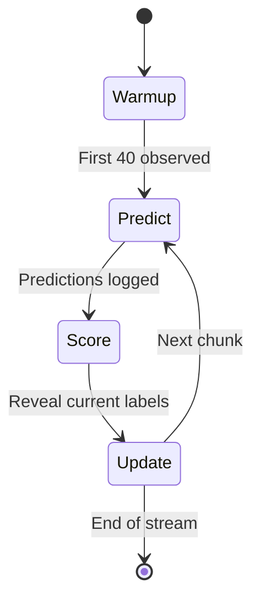

# NumCompute-Stream

**Project timeline:** **2026** portfolio extension of the COMP 5004 NumCompute group project at Adelaide University. The extension adds streaming evaluation and a Palmer Penguins dashboard.

Streaming-oriented, tree-based machine learning implemented with NumPy.

This extends the base NumCompute package with chunk-wise processing and a shared
`partial_fit` interface for applicable estimators and transformers. The tree
estimators **buffer observed examples and rebuild their trees** as chunks arrive;
this is not a bounded-memory online tree algorithm. The repository implements
its own models and pipelines rather than delegating them to scikit-learn.

---


## Follow a chunk through the stream



On the Palmer Penguins demo, the default tree scored **94.4%** and the past-majority baseline **44.0%** across **302** scored observations. The ordering keeps each chunk's labels out of its own predictions.

## What is in the box

| module | what it does |
|---|---|
| `stats.py` | Welford running mean/variance, streaming histogram, quantiles |
| `preprocessing.py` | StandardScaler, MinMaxScaler, Imputer, OneHotEncoder with partial_fit |
| `metrics.py` | Accuracy, loss, precision, recall, F1, confusion matrix, rolling window |
| `io.py` | CSV loader, chunked reader, in-memory stream splitter |
| `tree.py` | Decision tree classifier with Gini/entropy and partial_fit |
| `ensemble.py` | Random Forest, Bagging, and a unified EnsembleClassifier wrapper |
| `pipeline.py` | Pipeline with preprocessing fitted on the first chunk and incremental estimator updates |
| `stream.py` | StreamTrainer for the chunk loop, metric logging, and timing |
| `visualise.py` | Metric plots, model comparison, confusion matrix heatmap |

---

## Installation

```bash
git clone https://github.com/Khushx11/numcompute-penguins-streaming.git
cd numcompute-penguins-streaming
pip install -e ".[dev]"
```

Python 3.10+, NumPy, and matplotlib. That is all.

---

## Interview dashboard

After installing the package, run `python portfolio_demo.py` and open http://127.0.0.1:8004. Select a tree or random forest and a batch size. The dashboard compares test-then-train accuracy with a majority baseline derived from earlier labels and shows feature-buffer growth. Use **Inspect a batch** to connect scores and buffer growth to a point on the chart. The dashboard credits the original COMP 5004 team and describes the separate streaming extension.

The data options are [Palmer Penguins](demo/data.md) and a labelled synthetic stream with a known concept reversal. The default tree run on Penguins scores **94.4%** across **302 scored observations**, versus **44.0%** for the past-majority baseline. The first 40 observations initialise the model. The source identifies years, so the demo processes records by year with a fixed seeded order within each year. It is a repeatable benchmark demonstration rather than an operational event stream.

## Quick start

```python
import numpy as np
from numcompute_stream.io import make_stream_chunks
from numcompute_stream.preprocessing import StandardScaler
from numcompute_stream.ensemble import RandomForestClassifier
from numcompute_stream.pipeline import Pipeline
from numcompute_stream.stream import StreamTrainer
import numcompute_stream.visualise as vis

rng = np.random.default_rng(0)
X = rng.normal(size=(200, 4))
y = (X[:, 0] + X[:, 1] > 0).astype(int)

chunks = make_stream_chunks(X, y, chunk_size=20)

pipe = Pipeline([
    ('scale', StandardScaler()),
    ('model', RandomForestClassifier(n_estimators=10, max_depth=4, random_state=0)),
])

trainer = StreamTrainer(pipe, classes=[0, 1])
trainer.run(chunks)  # sanity-check mode: scores after fitting each chunk
trainer.summary()

vis.plot_metric_over_time(
    trainer.cumulative_accuracy_history(),
    title='Cumulative accuracy over chunks',
    ylabel='accuracy',
)
```

---

## Evaluation without same-chunk training leakage

The original `run()` mode measures each chunk **after** fitting it. For a
test-then-train evaluation, use:

```python
chunks = make_stream_chunks(X, y, chunk_size=20)
trainer = StreamTrainer(
    RandomForestClassifier(n_estimators=10, max_depth=4, random_state=0),
    classes=[0, 1],
)
log = trainer.run_prequential(chunks)
evaluated = [row for row in log if row["evaluated"]]
```

The first chunk initialises the model and is excluded from evaluation;
subsequent chunks are predicted **before** their labels are used for training.
See [the evaluation protocol](docs/evaluation-protocol.md) for metric definitions,
assumptions, and limitations.

---

## The streaming API

Every component follows the same interface so pieces are interchangeable
without rewriting anything around them:

```
partial_fit(X, y)   update with one chunk, call as many times as needed
fit(X, y)           full fit on a single dataset, clears previous state
transform(X)        apply fitted transform to new data
predict(X)          predict class labels
predict_proba(X)    class probability estimates
```

---

## Running the demo

```bash
cd demo
jupyter notebook stream_demo.ipynb
```

The notebook loads penguins.csv, splits it into 10-sample chunks, and trains
a decision tree, random forest, and bagging ensemble side by side. Plots
include cumulative accuracy over time, loss, a model comparison, predictions
vs ground truth on the last chunk, and a full confusion matrix.

---

## Running the tests

```bash
pytest tests/ -v
```

The regression suite covers normal cases and edge cases, including: NaN inputs,
zero-variance features, single-sample chunks, rolling window accuracy,
incremental category expansion in the encoder, shape mismatches, and
calling predict before fit.

---

## Running the benchmarks

```bash
python benchmark/run_benchmarks.py
```

Four comparisons: loop vs vectorised NaN imputation, loop vs vectorised
confusion matrix building, single tree vs Random Forest vs Bagging over
streaming chunks, and StandardScaler partial_fit cost as chunk count grows.

---

## Evaluation scope and limitations

- `StreamTrainer.fit_chunk` trains on the current chunk before reporting accuracy
  on that **same chunk**. These figures describe in-sample performance, not
  a held-out estimate of future streaming accuracy.
- The accumulating tree buffers require increasing memory and rebuilding cost;
  a bounded-memory stream learner would require a different algorithm.
- The benchmarks demonstrate implementation behaviour on example workloads;
  they should not be interpreted as production performance guarantees.
- Prefer `run_prequential` for test-then-train measurement; use an independently
  held-out dataset to assess deployment generalisation.

---

## Design notes

The tree uses a rebuild-from-buffer strategy rather than a proper online
algorithm like Hoeffding trees. Each partial_fit call adds the new chunk
to an internal buffer and rebuilds the whole tree from scratch. Hoeffding
trees handle truly unbounded streams more efficiently but the statistical
bounds they rely on are hard to implement correctly and even harder to
write good tests for. The rebuild approach trades memory efficiency for
simplicity and correctness, and the benchmark shows exactly how the cost
grows so there are no surprises.

Running mean and variance use Welford's algorithm throughout stats.py and
preprocessing.py. It runs in O(1) per sample, stores nothing from previous
chunks, and stays numerically stable where a naive sum-of-squares would
drift on large inputs.

Random Forest and Bagging share the same EnsembleClassifier interface so
switching between them is a single constructor argument. The only real
difference is feature subsampling at each split: Random Forest does it,
Bagging does not.

---

## Repo layout

```
NumCompute-Stream/
├── numcompute_stream/   core package (9 modules)
├── numcompute/          base NumCompute package
├── tests/               test suite
├── demo/                stream_demo.ipynb + penguins.csv
├── benchmark/           run_benchmarks.py
├── report/              report.pdf
└── README.md
```

---

## Project provenance and contributions

The base `numcompute/` package comes from the [original NumCompute group project](https://github.com/jaineel11/NumCompute), completed for Programming for Artificial Intelligence (COMP 5004) at Adelaide University. The original README credits these contributions:

- **[Khush Bhavin Maru](https://github.com/Khushx11)** implemented `sort_search.py` and `rank.py`, covering sorting, top-k, quickselect, binary search and ranking with ties.
- **Jaineel Patel** (@jaineel11) contributed `utils.py` and `io.py`.
- **Harshal Lad** (@Harshal192) contributed `preprocessing.py` and `pipeline.py`.
- **Vaibhav Patel** (@vaibhavpatel26) contributed `stats.py`, `metrics.py`, `optim.py` and `benchmarking.py`.

Khush maintains this portfolio edition, which adds the streaming extension in `numcompute_stream/`, test-then-train evaluation, and a Palmer Penguins dashboard.

### Verification of the original project

The [original coursework snapshot](coursework/NumCompute-main/) preserves the group README, package, test suite, benchmark script and recorded timings, quickstart notebook, and example CSV from the supplied archive. Its original installation and execution instructions apply from that directory. The streaming edition runs from the repository root.

All 11 base package files in this edition match the supplied group archive byte for byte. In a local run of the original archive, 149 tests passed, all 23 quickstart notebook code cells executed, and the benchmark script completed. The notebook uses the archive’s 10-row example CSV. On that machine, the original sort and top-k routines took about 22 times as long as their Python sort baselines. The scaler and pairwise-distance routines took about 1/30 and 1/369 of the corresponding loop times.

The original GitHub repository requires collaborator access. This portfolio edition is shared with permission for the group code. The original team credits are preserved in the coursework snapshot.
